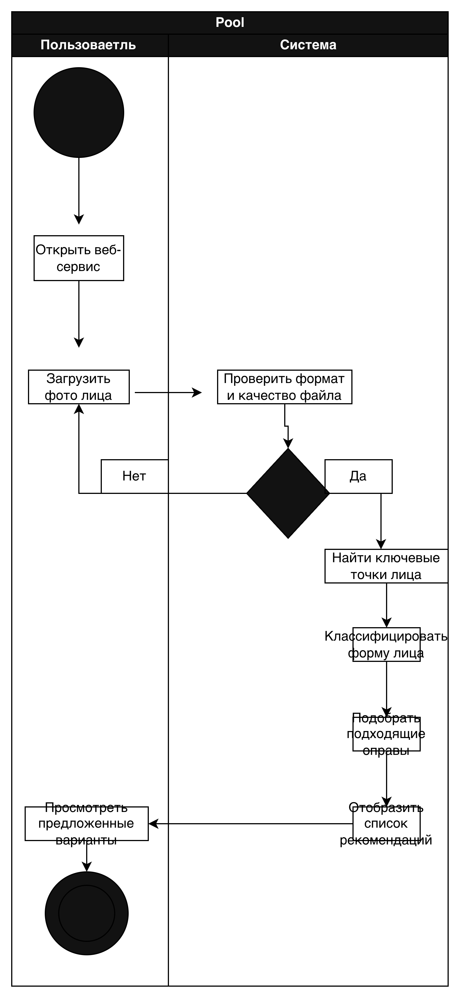
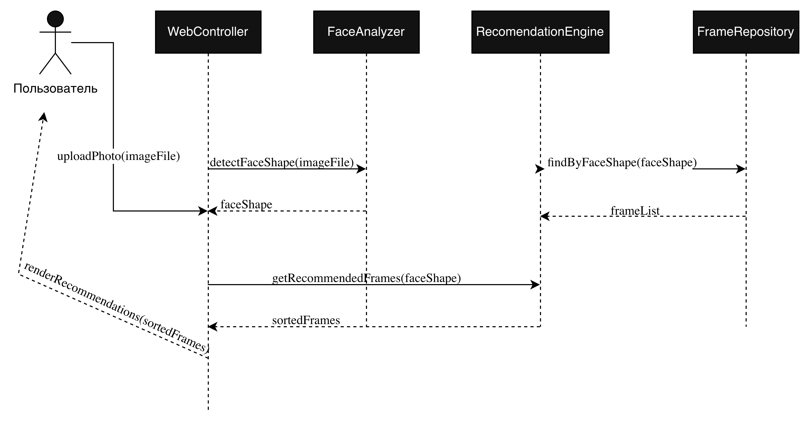

# Бет пішіні бойынша көзілдірік жақтауын таңдауға арналған веб-сервис
Автор: Дузельбаев Динмухаммед, ВТиПОук-25-5

## Мәселе
Көзілдірік сатып алу кезінде пайдаланушылар өз бетінің пішіні мен пропорцияларына сәйкес келетін жақтауды таңдауда қиналады. Бұл жоба компьютерлік көру және жасанды интеллект әдістерін қолдана отырып, пайдаланушының фотосуреті бойынша оңтайлы көзілдірік жақтауларын автоматты түрде ұсынатын онлайн-сервис құруға бағытталған.

## Акторлар
- Пайдаланушы (Клиент)
- Жүйе әкімшісі

## Талаптар
### Функционалдық
1. Жүйе пайдаланушының бет фотосуретін жүктеуге мүмкіндік беруі керек.
2. Жүйе фотосуреттен бет пішінін анықтап, сәйкес көзілдірік жақтауларын ұсынуы керек.

### Функционалдық емес
1. Суретті өңдеу және ұсыныс беру уақыты 5 секундтан аспауы тиіс.

## Диаграммалар
### 1. Use Case

### 2. Class

### 3. Activity: Бет суреті бойынша көзілдірік жақтауын таңдау

### 4. Sequence: Бет суреті бойынша көзілдірік жақтауын таңдау

